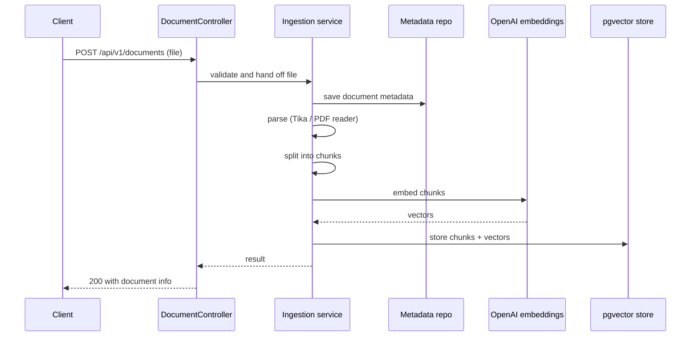
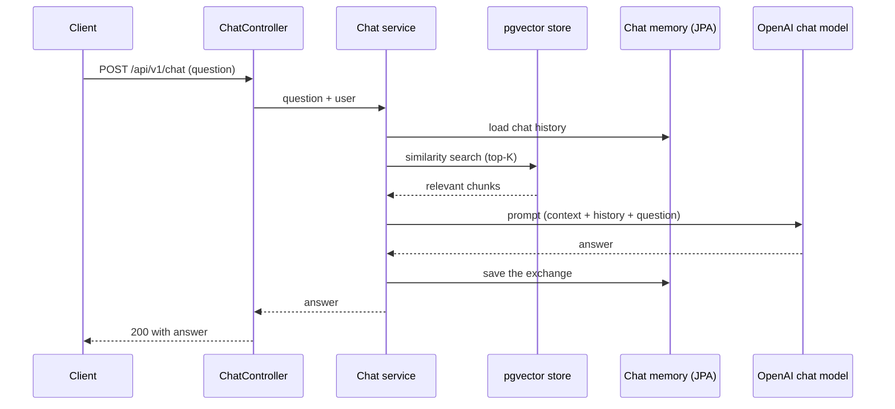

# knowra: Architecture

> **Status: Core RAG infrastructure implemented. Key pieces remain to complete the RAG chat functionality.**
>
> Scope: backend only.

## 1. Overview

knowra is a Retrieval-Augmented Generation (RAG) backend. Users register, upload documents, and ask questions about them through a chat API. Uploaded documents are parsed, split into chunks, embedded, and stored in PostgreSQL with the pgvector extension. At question time the most similar chunks are retrieved and sent to the LLM together with the question and the chat history, so answers are grounded in the user's own documents. Spring AI provides the document readers, vector store and LLM integration.

## 2. Tech stack

| Layer | Choice | Status |
|---|---|---|
| Language / framework | Java 21, Spring Boot 4.1.1 | In place |
| AI framework | Spring AI (OpenAI and pgvector starters) | Dependencies in place, beans not written |
| Database | PostgreSQL 16 with pgvector (`pgvector/pgvector:pg16`), host port 5434 | In place |
| Schema management | Flyway migrations, `ddl-auto: validate` | In place |
| Auth | Spring Security + JWT (jjwt) | Dependencies present, not configured |
| Document parsing | Spring AI Tika reader and PDF reader | **Not in pom yet** |
| Retrieval | `spring-ai-vector-store-advisor` | **Not in pom yet** |
| Mapping | ModelMapper | Dependency present |
| API docs | springdoc-openapi | Dependency present |
| Build | Maven (`../mvnw`) | In place |

## 3. Package layout (target)

```
io.github.lakshaybxt.knowra
├── controller/      REST controllers
├── service/         service interfaces
├── service/impl/    implementations
├── repository/      Spring Data JPA repositories
├── entity/          JPA entities
├── dto/             request/response DTOs and envelopes
├── exception/       custom exceptions + global handler
└── configuration/   Spring AI, security, OpenAPI, properties
```

## 4. Components (not built yet)

| Component | Responsibility |
|---|---|
| `DocumentController` | Upload and list documents |
| `ChatController` | Accept a question, return the RAG answer |
| `DocumentRepository` | Persist document metadata |
| `AIConfiguration` | Chat model, embedding model and vector store beans |
| `SecurityConfig` | Stateless JWT filter chain |
| `CustomJpaChatMemory` | Persist chat history in the database |
| Ingestion service | Turn an uploaded file into vector chunks: parse, split, embed, store |
| `GlobalExceptionHandler` | Central error handling with a standard error envelope |

## 5. Data model

| Table | Purpose | Status |
|---|---|---|
| `vector_store` | Embeddings and chunk text, managed through Spring AI pgvector. Columns: `id UUID`, `content TEXT`, `metadata JSON`, `embedding VECTOR(1536)` | Created in `V1__create_vector_store.sql` |
| Users | Credentials and profile | Planned |
| Document metadata | Filename, content type, upload time, owner | Planned |
| Chat history | Messages per conversation, used by the persistent chat memory | Planned |

Database setup: `docker-compose up -d` starts `pgvector/pgvector:pg16` on port 5434 with database `knowra`. The `vector` and `uuid-ossp` extensions are created by the V1 migration.

## 6. API endpoints (planned)

| Method | Path | Purpose |
|---|---|---|
| POST | `/api/v1/auth/register` | Register a user |
| POST | `/api/v1/auth/login` | Authenticate and issue a JWT |
| POST | `/api/v1/documents` | Upload and index a document |
| GET | `/api/v1/documents` | List the user's documents |
| POST | `/api/v1/chat` | Ask a question, get a RAG answer |

## 7. Key flows

### Document ingestion



### RAG chat



Retrieval must be scoped to the requesting user: store the owner's id in each chunk's metadata at ingestion time and filter on it during the similarity search. Without that filter, one user's questions can surface another user's documents.

## 8. Configuration

| Setting | Value |
|---|---|
| Embedding dimensions | 1536 (must match the embedding model's output) |
| Chunk size / overlap | 600 / 100 |
| Top-K | 5 |
| OpenAI key | env var `OPENAI_API_KEY` |
| Upload limits | 25MB per request, 50MB total |

## 9. Build order

| # | Step | Status |
|---|---|---|
| 1 | Docker Compose with pgvector | Config exists |
| 2 | Database connectivity | `application.yaml` done |
| 3 | Spring AI / OpenAI config | Properties set, beans not written |
| 4 | SpringDoc OpenAPI | Dependency present |
| 5 | Document upload and ingestion | Not started |
| 6 | RAG chat endpoint | Not started |
| 7 | JWT auth and Spring Security | Not started |
| 8 | Users and document listing | Not started |
| 9 | Persistent chat memory | Not started |

Two things to watch while building:

- **Security starter locks everything.** `spring-boot-starter-security` is already on the classpath, so once controllers exist every endpoint, Swagger included, will return 401 until a `SecurityConfig` is added. Add a permissive config early, then tighten it at step 7.
- **Schema validation.** `ddl-auto: validate` with Flyway means each new entity needs its migration (`V2__...`, `V3__...`) before the app will start.

## 10. Dependencies to add

- `spring-ai-tika-document-reader`
- `spring-ai-pdf-document-reader`
- `spring-ai-vector-store-advisor`

Versions are managed by the Spring AI BOM, so no explicit version should be needed.

## 11. Open questions

- Which embedding model to use, and keeping its dimensions in sync with `VECTOR(1536)`.
- Which splitter class to use, and final chunk settings.
- How very large PDFs are handled beyond standard splitting.
- Token and rate limits for the chat model.
